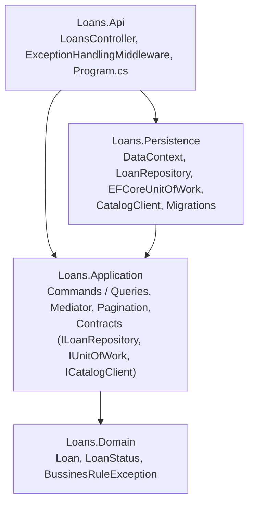

# Loans Microservice — Sistema de Préstamo de Licencias

Microservicio de **préstamos**. Registra quién pidió prestada qué licencia, hasta cuándo y si ya la devolvió. No guarda usuarios (eso es Identity) ni licencias (eso es Catalog): solo guarda sus Id.

## Responsabilidad de este microservicio

| Concepto | Descripción |
|---|---|
| **Loan** | Préstamo de una licencia a un usuario, con fecha de inicio, fecha límite y estado |
| **LoanStatus** | `Active` o `Returned`. «Vencido» no se guarda: se calcula (activo y con la fecha límite ya pasada) |

## Cómo se comunican los tres servicios

1. El usuario hace login en **Identity** (puerto 5086) y recibe un JWT.
2. Envía ese token a **Loans** (puerto 5090) para pedir prestado un software.
3. Loans lee del token quién es el usuario y le pide a **Catalog** (puerto 5080) una licencia libre de ese software, reenviando el mismo token.
4. Catalog marca la licencia como ocupada (`Assign()`) y responde con su Id.
5. Loans guarda el préstamo.
6. Al devolver, Loans le pide a Catalog que libere la licencia (`Release()`).

Si Catalog no responde, Loans devuelve **503** en lugar de un error genérico.

## Tecnologías

- .NET 10 / ASP.NET Core Web API
- Entity Framework Core + SQL Server
- CQRS con Mediator propio
- Autenticación con JWT emitido por Identity
- HttpClient para la comunicación con Catalog
- MSTest para pruebas unitarias

## Arquitectura



`Domain` no depende de nadie; `Application` solo de `Domain`; `Persistence` y `Api` dependen de `Application`. Application no sabe que Catalog se llama por HTTP: solo conoce la interfaz `ICatalogClient`.

## Modelo de dominio

- **Loan**: `Id`, `UserId`, `SoftwareId`, `LicenseId`, `StartDate`, `DueDate`, `ReturnedAt`, `ExtensionsCount`, `Status`
  - `Return()`: solo si está activo; pasa a `Returned` y guarda la fecha de devolución.
  - `Extend(extraDays)`: solo si está activo y no ha sido extendido; suma los días a la fecha límite.
  - `IsOverdue(now)`: activo y con la fecha límite ya pasada.

## Reglas de negocio

- Un préstamo dura entre 1 y 30 días.
- Un usuario puede tener máximo 3 préstamos activos.
- Un préstamo se puede extender una sola vez, hasta +7 días.
- Solo se puede devolver o extender un préstamo que esté activo.
- El dueño del préstamo o un Admin puede verlo y devolverlo. Solo el Admin lista todos.
- «Vencido» no se guarda: se calcula.

Las reglas puras viven en la entidad `Loan`; el tope de 3 préstamos activos vive en el caso de uso porque necesita consultar la base de datos.

## Endpoints

Todos requieren JWT de Identity.

### Loans (puerto 5090)

| Tipo | Caso de uso | Endpoint | Respuesta |
|---|---|---|---|
| Command | Solicitar préstamo | `POST /api/loans` | 201 con `{ id }` |
| Command | Devolver préstamo | `POST /api/loans/{id}/return` | 204 |
| Command | Extender préstamo | `POST /api/loans/{id}/extend` | 204 |
| Query | Mis préstamos (paginado) | `GET /api/loans/my` | 200 |
| Query | Préstamo por Id (dueño o Admin) | `GET /api/loans/{id}` | 200 |
| Query | Todos los préstamos, filtro `onlyOverdue` (solo Admin) | `GET /api/loans` | 200 |

### Catalog (puerto 5080), usados por Loans

| Endpoint | Respuesta |
|---|---|
| `POST /api/software/{softwareId}/licenses/assign` | 200 con `{ licenseId }`, o 400 si no hay licencias libres |
| `POST /api/license/{licenseId}/release` | 200 |

### Códigos de error

| Código | Cuándo |
|---|---|
| 400 | Se rompe una regla de negocio (días fuera de rango, ya devuelto, ya extendido, tope de préstamos, sin licencias) |
| 401 | No hay token, el token es inválido o expiró |
| 403 | El usuario no tiene el rol requerido, o intenta ver/devolver/extender un préstamo ajeno |
| 404 | El préstamo no existe |
| 503 | Catalog no está disponible |

## Cómo ejecutar los tres servicios

### Requisitos

- .NET 10 SDK
- SQL Server local (las cadenas de conexión usan `Server=.`)
- `dotnet-ef`: `dotnet tool install --global dotnet-ef`

### 1. Crear las bases de datos

Desde la raíz del repositorio:

```bash
dotnet ef database update --project Identity/Identity.App
dotnet ef database update --project Catalog/Catalog.Persistence --startup-project Catalog/Catalog.Api
dotnet ef database update --project Loans/Loans.Persistence --startup-project Loans/Loans.Api
```

Se crean `IdentityDb`, `CatalogDb` y `LoansDb`.

### 2. Arrancar en este orden (una terminal por servicio)

```bash
dotnet run --project Identity/Identity.App --launch-profile http
dotnet run --project Catalog/Catalog.Api --launch-profile http
dotnet run --project Loans/Loans.Api --launch-profile http
```

Al arrancar, Identity crea los usuarios y roles de prueba, y Catalog crea categorías, software y 3 licencias por software.

### 3. Usuarios de prueba

| Usuario | Contraseña | Roles |
|---|---|---|
| `admin@licencias.local` | `1234*` | Admin, Catalog Manager |
| `catalogmanager@licencias.local` | `1234` | Catalog Manager |
| `user@licencias.local` | `1234` | User |

### 4. Probar

- Swagger de Loans: `http://localhost:5090/swagger`
- O el archivo `Loans.Api/Loans.Api.http`, con las peticiones en orden y el resultado esperado de cada una.

### 5. Pruebas unitarias

```bash
dotnet test Loans/Loans.slnx
```

Cubren los comandos (solicitar, devolver, extender) y las consultas, con repositorio, Catalog y Unit of Work falsos, sin base de datos.

## Limitaciones conocidas

- Los endpoints `assign` y `release` de Catalog aceptan a cualquier usuario autenticado, así que se podrían llamar directamente sin pasar por Loans. En un sistema real se protegerían con un token entre servicios o un rol especial.
- Si dos usuarios piden la última licencia al mismo tiempo podría haber una condición de carrera. Se arreglaría con control de concurrencia en Catalog.